<div align="center">

<a href="https://noetic.lol"></a>

<p>
<a href="https://noetic.lol"></a>

<a href="./LICENSE"></a>
<a href="./SUPPORT.md"></a>
</p>

<p><a href="https://noetic.lol"><b>Open Noetic</b></a> &nbsp;·&nbsp; <a href="https://github.com/loverhaterlmao/snns-suite/blob/main/ACCESS.md"><b>Get in</b></a> &nbsp;·&nbsp; <a href="https://github.com/loverhaterlmao/snns-suite/blob/main/TUTORIALS.md"><b>First hour</b></a> &nbsp;·&nbsp; <a href="./API.md"><b>API</b></a> &nbsp;·&nbsp; <a href="./PRICING.md"><b>Pricing</b></a> &nbsp;·&nbsp; <a href="./FAQ.md"><b>Questions</b></a></p>

</div>

<br>

<!-- v2:a -->
<table>
<tr>
<td width="150" align="center"></td>
<td>
<b>Noetic Suite for Windows</b>: get it at <a href="https://noetic.lol/download">noetic.lol/download</a>. Anyone can create a free account. <a href="https://github.com/loverhaterlmao/noetic-suite/releases/latest">The release notes</a> carry the checksum to check your download against, not the file.
<br><br><b>On a phone:</b> open <a href="https://noetic.lol">noetic.lol</a> in your browser and choose <i>Add to Home Screen</i> (iPhone: the Share button; Android: the menu, then <i>Install app</i>).
</td>
</tr>
</table>
<!-- /v2:a -->


## What it does

One AI assistant with a whole studio behind it. Ask in a sentence and get it finished: a game, a site, a document, a picture. Planned, built, run, reviewed and fixed before it reaches you.

<table>
<tr><td width="25%" valign="top"><b>Chat</b><br><sub>Answers with care, with sources when it looks things up.</sub></td><td width="25%" valign="top"><b>Cowork</b><br><sub>Hand over a task and get the finished thing back.</sub></td><td width="25%" valign="top"><b>Code</b><br><sub>Describe software in a sentence. It comes back planned, built, run, reviewed and fixed.</sub></td><td width="25%" valign="top"><b>Create</b><br><sub>Pictures in the style you choose, with an editor to finish them.</sub></td></tr>
</table>

## How a build goes

```text
  you ask ──▶ plan ──▶ build (several versions at once) ──▶ run and compare
                                                               │
   report ◀── final check ◀── fix ◀── attack it ◀── review ◀───┘
```

The report says plainly what was built, what was checked, and what was **not** done.

## Getting in

Anyone can create a free account on the front page of [noetic.lol](https://noetic.lol): an email address and a
password, or a GitHub account. The free plan has a daily limit; what the paid plans cost is on the
[pricing page](https://noetic.lol/pricing).

## In your language

The public pages (the front page, pricing, questions and download) are written in 18 languages: English, Spanish, Portuguese, French, German, Italian, Dutch, Polish, Turkish, Russian, Ukrainian, Arabic, Hindi, Indonesian, Vietnamese, Japanese, Korean and Chinese.
Your browser's own language is chosen for you, each language has its own address (for example
[noetic.lol/es/](https://noetic.lol/es/)), and every page carries a list to switch.

## Use it from your own programs

```bash
curl https://noetic.lol/v1/chat/completions \
  -H "Authorization: Bearer $NOETIC_KEY" -H "Content-Type: application/json" \
  -d '{"model":"noetic-0.1","messages":[{"role":"user","content":"Hello"}]}'
```

It speaks the chat format most libraries already use. Keys, streaming, errors and limits: [API.md](API.md).

## Plans

Free during early access. Planned: **Pro** $20, **Overdrive** $60, **Team** $25 a seat, **Organization** $40 a seat,
pay-as-you-go credit from $5. What each includes: [PRICING.md](PRICING.md).

## Apps

| | |
|---|---|
| **Web** | [noetic.lol](https://noetic.lol) |
| **Windows** | [noetic.lol/download](https://noetic.lol/download), or one line in a terminal (below) |
| **Terminal** | `noetic`, a command that works in any folder (below) |
| **Phone** | Open noetic.lol and choose *Add to home screen* in your browser's menu |

## From a terminal

One line in PowerShell downloads the Windows app, checks it against its checksum, and installs it without asking anything:

    irm https://noetic.lol/install.ps1 | iex

It also gives you `noetic`, a command that works in any folder:

    noetic                        # talk to it here: it plans, builds and writes the files into this folder
    noetic "build a to-do app"    # say one thing first, then carry on
    noetic -p "what is a tide"    # one answer, for scripts and pipes
    noetic keys new               # make an API key
    noetic get apps               # fetch the other S&NS apps

The install script is short and plain; [read it](https://noetic.lol/install.ps1) before you run it if you like.

## Connect your tools

Noetic can use the tools of services you already have, through the Model Context Protocol: documentation servers that need no account, services where you sign in on their own page (Notion, Linear, Sentry, Figma, Canva and others), and any server of your own by its address. Looking things up is automatic; anything that changes something in another service asks you first. It is under **Customize → Connectors**.

<!-- v2:b -->
## The desktop app



- **Getting it:** [noetic.lol/download](https://noetic.lol/download), no account needed. It is a zip; unzip it and open `NoeticSuite.exe` once. It installs itself for your Windows account (no administrator rights), appears in your Start menu and under Installed apps, and opens from there from then on.
- **What is in it:** Noetic Suite itself, which runs on your computer, and *Noetic Panel*, for people on the team.
- **Checking it:** the download page shows the file's SHA-256, and so do [the release notes](https://github.com/loverhaterlmao/noetic-suite/releases/latest).
- **The warning Windows shows:** "unknown publisher", the first time. The app is not code-signed yet. Check the file's
  SHA-256 against the one in the release notes if you want to be sure it is ours.

## Built with

<p>      </p>

The source is closed, so GitHub's own language bar has nothing to count here. This is what Noetic Suite is written in and runs on.

## The small print

[Terms of use](TERMS.md) · [Privacy](PRIVACY.md) · [Acceptable use](ACCEPTABLE_USE.md) · [Licence](LICENSE)
<!-- /v2:b -->

## In this repository

| File | |
|---|---|
| [API.md](API.md) | Calling Noetic from your own programs |
| [PRICING.md](PRICING.md) | Plans, seats, credit |
| [FAQ.md](FAQ.md) | The questions people ask first |
| [ROADMAP.md](ROADMAP.md) | What is being worked on |
| [CHANGELOG.md](CHANGELOG.md) | What changed, and when |
| [SECURITY.md](SECURITY.md) · [SUPPORT.md](SUPPORT.md) | Reporting a weakness · reaching a person |
| [CONTRIBUTING.md](CONTRIBUTING.md) | How to help when the source is closed |
| [LICENSE](LICENSE) | What you may and may not do |

## Issues

Use this repository's issues for things that are broken or missing. Say what you asked for, what came back and what
you expected. Never put passwords, keys or personal details in an issue.

<br>

<div align="center">

<sub>Part of the S&NS family</sub><br>
<a href="https://github.com/loverhaterlmao/noetic-suite"><b>Noetic Suite</b></a> &nbsp;·&nbsp; <a href="https://github.com/loverhaterlmao/claw"><b>Claw</b></a> &nbsp;·&nbsp; <a href="https://github.com/loverhaterlmao/sykbot"><b>Sykbot</b></a> &nbsp;·&nbsp; <a href="https://github.com/loverhaterlmao/beat-rip"><b>Beat.rip</b></a> &nbsp;·&nbsp; <a href="https://github.com/loverhaterlmao/ink"><b>Ink</b></a><br><br>
<a href="https://snns.dev"><b>snns.dev</b></a> &nbsp;·&nbsp; <a href="https://github.com/loverhaterlmao/snns-suite">S&NS Suite</a> &nbsp;·&nbsp; <a href="mailto:support@snns.dev">support@snns.dev</a>

<sub>© Sick & Nexra Studios. All rights reserved. No licence to the software is granted by this repository.</sub>

</div>
